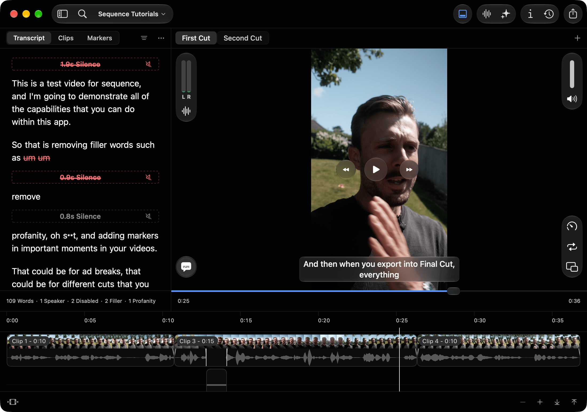

# Sequence Tool®

**Sequence Tool** is a native (Swift + Rust) macOS app for editing video like text. Find the story in long recordings, clean and sync every angle, and export on Mac.

As featured in Larry Jordan's Edit Smarter Newsletter.

[Visit Sequence Tool](https://sequencetool.com) · [Download Sequence](https://sequencetool.com/download) · [Documentation](https://sequencetool.com/docs/what-is-sequence/) · [Report an issue](../../issues/new/choose)

## What Sequence does

### Text-based editing & cleanup

- Transcribe spoken video and audio on-device into searchable, time-aligned transcripts on Apple silicon
- Cut unwanted sections and rearrange sentences or clips in the transcript, with every edit non-destructive and reversible
- Automatically remove silence, filler words, and profanity (skip, silence, or beep) for tighter pacing
- Identify speakers locally and organize recurring People across projects
- Search inside transcripts and across Catalogs to locate spoken moments in your library
- Create multiple Variants for full episodes, clean cuts, chapters, and social clips without duplicating source recordings

### Multi-Cam & visual timeline

- Sync multiple cameras and external audio, then build a Multi-Cam programme with editable automatic camera cuts
- Refine edits on a visual timeline with video thumbnails, audio waveforms, and asset layers
- Keep your transcript, Clips view, and timeline continuously in sync
- Normalize audio non-destructively while keeping original media untouched

### Assets, layouts & local automation

- Place images, video, audio, and live linked Variants from your asset library onto the timeline
- Adjust framing, cropping, volume, and overlays for picture-in-picture or split-screen layouts with live preview
- Connect scripts or AI agents via the optional `sq` CLI and local MCP server for rough cuts, transcript cleanup, and exports - off by default, with edit sessions working on a protected copy by default

### Export & share

- Export finished video, audio, individual frames, transcripts (TXT, CSV), or subtitles (SRT, WebVTT, SBV, ASS)
- Hand off editable timelines to Final Cut Pro or DaVinci Resolve with cuts, multicam structure, layers, titles, markers, keywords, audio, and framing
- Share an optionally encrypted Sequence Package (`.sqbundle`) with media, transcripts, and edit decisions included

## Private and offline-first by design

Sequence works directly with the media you have, wherever it is stored:

- Native to macOS (Swift + Rust) on Apple silicon and macOS Sequoia 15.4 or later
- On-device transcription - your footage is never uploaded for transcription
- Offline-first editing workflow after activation and model downloads
- Works with media on your Mac, external drives, and reachable network storage without duplicating originals
- Encrypted local library with optional Touch ID app lock and optional encrypted iCloud library backup

## Get Sequence

Requires **Apple silicon and macOS Sequoia 15.4 or later** (`macOS 15.4+`).

- **Direct download**: Start with a 7-day free trial (no card required) at [sequencetool.com/download](https://sequencetool.com/download)
- **Mac App Store**: Free to download; an Annual subscription or one-time Lifetime purchase unlocks all features
- **Setapp**: Included with your Setapp membership
- **Sequence CLI (`sq`)**: Optional companion tool via Homebrew (`brew install rockstarsunlimited/sequence/sequence`) or `curl -fsSL https://sequencetool.com/install.sh | sh`

For product details, documentation, and current releases, visit [sequencetool.com](https://sequencetool.com).

## Support and bug reports

This repository is the public issue tracker for Sequence Tool.

Before opening an issue, please:

- Check existing issues to see whether the problem has already been reported
- Update to the latest available version of Sequence
- Remove or anonymise any private media, transcripts, account information, or other sensitive material from screenshots and logs

When reporting a bug, include as much of the following as you can:

- Sequence version and macOS version
- Your Mac model and chip, where relevant
- A short, reproducible set of steps
- What you expected to happen
- What happened instead
- Relevant screenshots, screen recordings, or non-sensitive logs
- Media type, codec, frame rate, and audio configuration, if the issue involves import, playback, transcription, or export

For questions about your account, billing, or private support matters, please use the contact options on [sequencetool.com/support](https://sequencetool.com/support) rather than posting sensitive information in a public issue.

## Security

Please **do not** report security vulnerabilities in public issues.

See [SECURITY.md](./SECURITY.md) for the responsible-disclosure process.

## License

Sequence Tool is proprietary software.

Copyright © Rock Stars Unlimited Ltd. All rights reserved.
